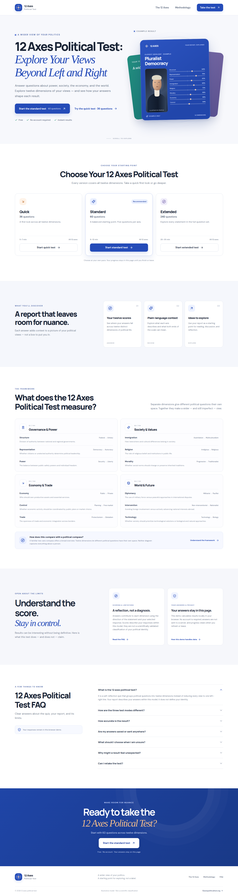
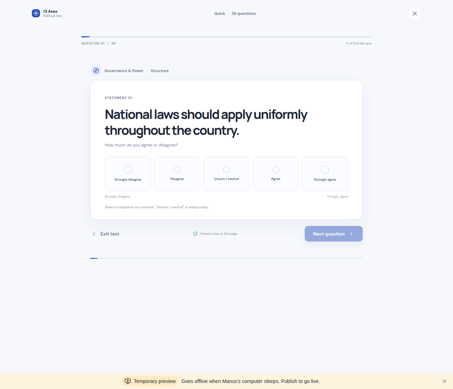
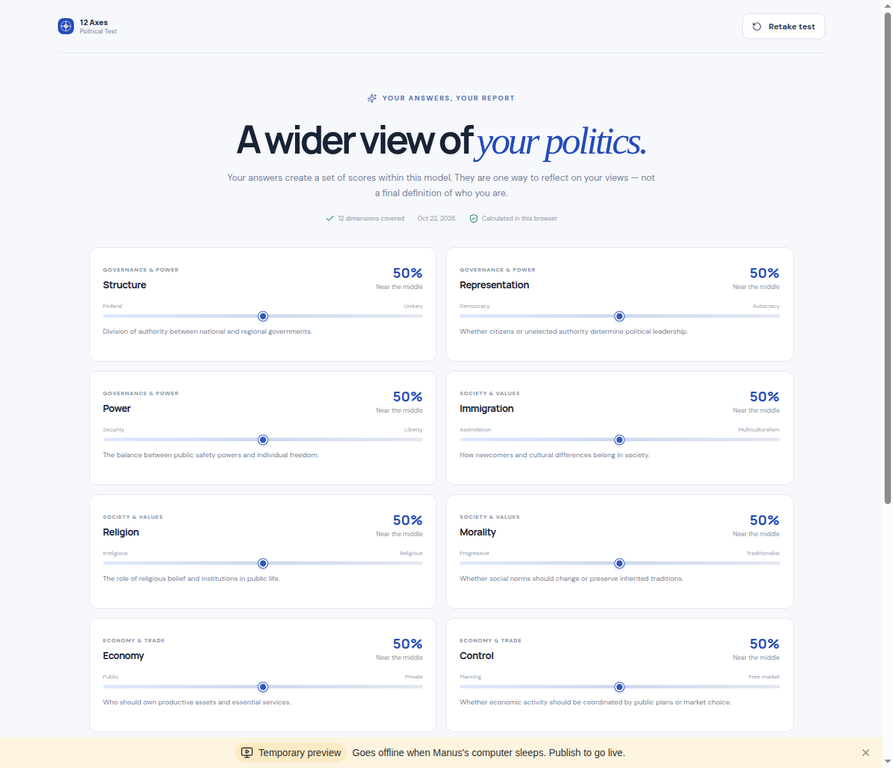
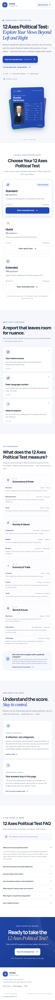

# 12 axes political test

<p align="center">
  <a href="https://12axespoliticaltest.org/">
    
  </a>
</p>

<p align="center">
  探索政治观点的 12 个维度，以更完整的视角理解自己的回答。
</p>

<p align="center">
  <a href="https://12axespoliticaltest.org/">访问 12 Axes Political Test</a>
</p>






## 简介

12 axes political test 是一个围绕权力与治理、社会与价值、经济与贸易、国际关系与未来发展等主题展开的政治观点测验。它将问题放在 12 个不同维度中呈现，帮助用户观察自己的回答，而不是将复杂观点压缩成单一的左—右标签。

本仓库包含网站首页、测试选择、逐题作答、浏览器内计分和结果解释。测试提供 Quick（36 题）、Standard（60 题）与 Extended（240 题）三种长度，三种模式都覆盖全部 12 个维度。

## 产品能力

- **12 个维度**：分别介绍维度含义、两端立场和对应分组。
- **三种题量**：Quick 为 36 题，Standard 为 60 题，Extended 为 240 题。
- **互动答题**：逐题作答，显示整体进度，支持前后导航与返回修改；选择一个回答后才能继续。
- **本地计分**：按陈述方向和回答值计算 12 个维度的百分比分数，并提供端点解释。
- **结果报告**：显示全部维度的结果、分数与简要解释，可重测或分享结果摘要。
- **常见问题与透明说明**：解释测试用途、题量、准确性限制以及答案处理方式。
- **响应式与键盘可用性**：支持桌面、平板和手机视口，交互控件使用原生按钮及可见焦点样式。

> 本仓库实现了完整的前端演示和本地计分逻辑。答案只保存在当前页面运行状态中，不发送到服务器；刷新或离开页面会清除答题进度。本项目不连接原站的认证、云端分享、账户、付费或结果 API。分数仅反映本演示题库和计分规则，不是经过科学验证的政治身份分类。

## 本地运行

### 环境要求

- Node.js 20 或更高版本
- pnpm 11.25.0（版本已在 `package.json` 中固定）

### 安装与启动

```bash
pnpm install
pnpm dev
```

打开 [http://localhost:3000](http://localhost:3000) 查看页面。

### 生产构建

```bash
pnpm build
pnpm preview
```

### 代码检查

```bash
pnpm lint
```

## 技术栈

- [React 19](https://react.dev/)
- [Vite 6](https://vite.dev/)
- [TypeScript 5](https://www.typescriptlang.org/)
- [Lucide](https://lucide.dev/) 图标
- 自定义 CSS 响应式样式

## 项目结构

```text
app.config.ts             # Manus 项目标识资源
index.html                # 标题、canonical、社交分享与初始可读内容
public/
  favicon.svg             # 12 维罗盘站点图标
  social-card.svg         # 社交分享卡片
  manus-routes.json       # 项目单页路由清单
  robots.txt              # 爬虫访问规则
  sitemap.xml             # 首页站点地图
src/
  App.tsx                 # 首页、测试流程、计分与结果报告
  main.tsx                # React 应用入口
  questions.ts            # 12 个维度与 240 道本地题库
  styles.css              # 桌面/移动端界面样式
```

## 开发说明

若要继续扩展，可将本地答案状态替换为明确授权的持久化或分享服务；也可添加可审阅的题目来源、版本化评分规则、国际化文案和结果导出。在接入任何远端服务前，应更新隐私说明，并避免把政治观点答案作为默认分析或广告数据。

## 图片与内容来源

本项目品牌图标、分享卡片与示例结果视觉由仓库内的 SVG/CSS 绘制。页面文案和题库为本仓库的前端演示内容；截图由本地运行页面生成。目标参考站点为 [12axespoliticaltest.org](https://12axespoliticaltest.org/)。原站资源的版权和使用许可仍以原站说明为准；本仓库不复制其肖像素材。

## 链接

- GitHub public 仓库：[12-axes-political-test](https://github.com/tonglovely1314-hub/12-axes-political-test)

- 官网地址：[12axespoliticaltest.org](https://12axespoliticaltest.org/)
- 测试入口：[开始标准测试](https://12axespoliticaltest.org/#test)
- 框架介绍：[12 个政治维度](https://12axespoliticaltest.org/#axes)
- 评分与隐私：[测试说明](https://12axespoliticaltest.org/#methodology)
- 常见问题：[FAQ](https://12axespoliticaltest.org/#faq)
